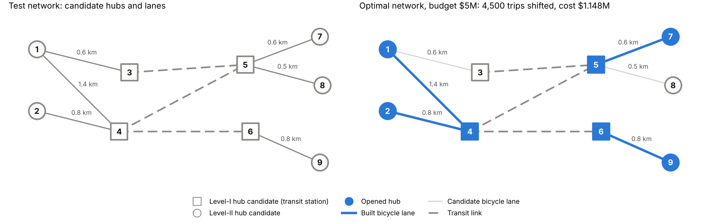
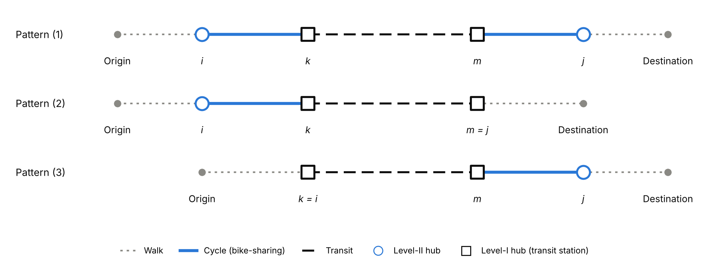
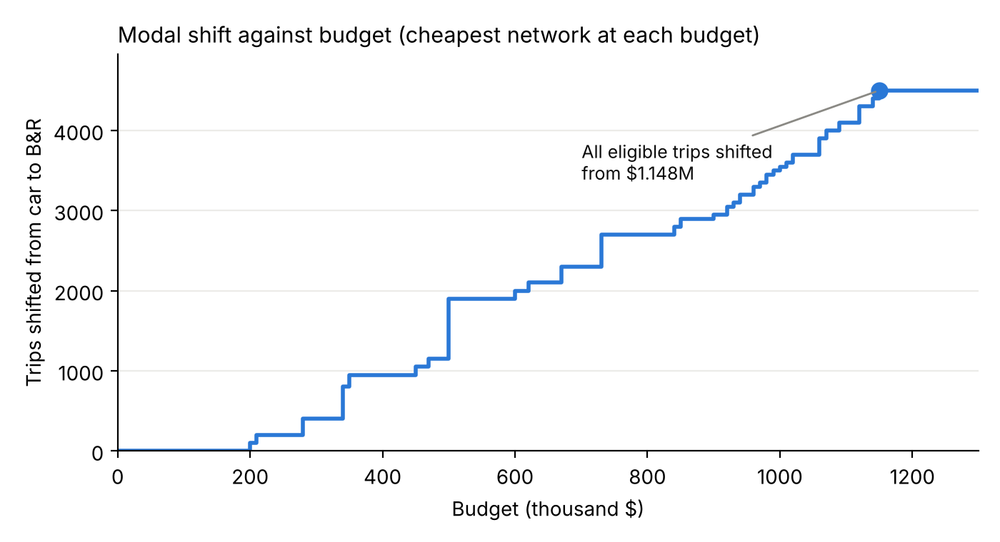
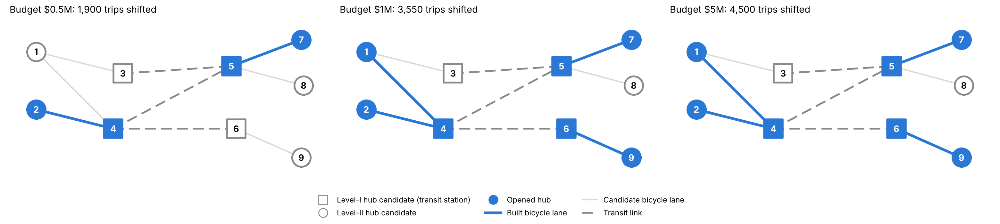
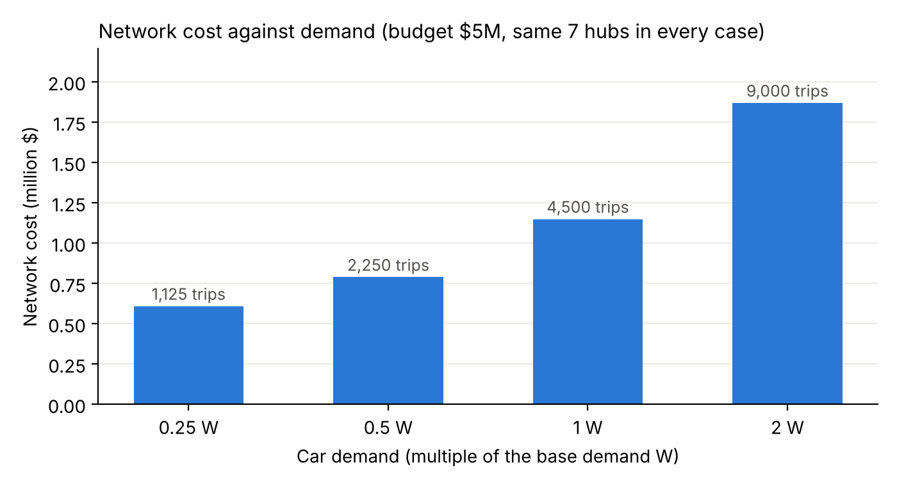

# Bike-and-Ride Hub Network Design (MILP, Python + Gurobi)

A replication of the Bike-and-Ride (B&R) hub network design model of Tavassoli and Tamannaei (2020), written in Python with Gurobi and solved on a small synthetic network.

*Course project for Modeling in Transportation Engineering, Isfahan University of Technology, fall 2022. Revised and uploaded November 2026.*



*Left: the 9-node test network with its candidate hubs and bicycle lanes. Right: the optimal network for a budget of \$5M.*

## Problem

Many car trips are too long for a bicycle alone and start or end too far from transit stations to use transit alone. A Bike-and-Ride trip combines the two: the traveler cycles from a bike-sharing (BSS) station to a transit station, rides transit, and cycles from the egress station to the destination.

A city has a fixed budget to build BSS stations (hubs) and bicycle lanes. Two kinds of hub candidates exist:

- **Level-I hubs**: transit stations that can host a BSS station.
- **Level-II hubs**: BSS station candidates outside the walking catchment of transit, within cycling range of at least one level-I hub.

The question is which hubs and lanes to build so that the largest number of car trips switch to B&R. A trip switches only if B&R is cheaper than the car for that origin-destination pair (generalized cost, including time and fares).

The paper defines three B&R trip patterns. This repository models pattern (1).



*B&R trip patterns. Redrawn and simplified from Tavassoli and Tamannaei (2020), Fig. 2.*

## Model

### Sets and parameters

| Symbol | Meaning |
|---|---|
| $H_I$, $H_{II}$ | level-I and level-II hub candidates; $H = H_I \cup H_{II}$ |
| $R_k$ | level-II hubs within cycling range of level-I hub $k$ |
| $A$ | corresponding pairs $(i,k)$ with $k \in H_I$, $i \in R_k$; $A_h$ = pairs that contain hub $h$ |
| $P$ | B&R paths $(i,k,m,j)$: cycle $i \to k$, transit $k \to m$, cycle $m \to j$ |
| $L$ | candidate bicycle lanes; lane $l$ serves pair $(i_l, k_l)$ and has length $d_l$ (km) |
| $w_{ij}$ | car trips from $i$ to $j$ |
| $\Delta_{ikmj}$ | 1 if B&R through $k$ and $m$ is cheaper than the car for $(i,j)$, else 0 |
| $\lambda$, $\delta$, $\gamma$ | site cost per hub (\$), capacity cost per trip through a hub (\$), lane cost (\$/km) |
| $B$ | budget (\$) |

### Decision variables

| Variable | Meaning |
|---|---|
| $z_h \in \{0,1\}$ | hub $h$ is opened |
| $y_{ik} \in \{0,1\}$ | pair $(i,k)$ is linked |
| $\eta_l \in \{0,1\}$ | lane $l$ is built |
| $x_{ikmj} \in \{0,1\}$ | trips from $i$ to $j$ switch to B&R through $k$ and $m$ |
| $\kappa_h \ge 0$ | installation cost of hub $h$ |

### Formulation

Constraint numbers follow the paper.

```math
\max \sum_{(i,k,m,j) \in P} w_{ij}\, x_{ikmj} \tag{1}
```

```math
x_{ikmj} \le y_{ik}, \qquad x_{ikmj} \le y_{jm}, \qquad x_{ikmj} \le \Delta_{ikmj} \qquad \forall (i,k,m,j) \in P \tag{2–4}
```

```math
\sum_{k,m:\,(i,k,m,j) \in P} x_{ikmj} \le 1 \qquad \forall i, j \in H_{II} \tag{5}
```

```math
\kappa_h = \lambda z_h + \delta \sum_{(i,k,m,j) \in P:\; h \in \{i,k,m,j\}} w_{ij}\, x_{ikmj} \qquad \forall h \in H \tag{6–7}
```

```math
\sum_{a \in A_h} y_a \ge 1 - M_h (1 - z_h), \qquad \sum_{a \in A_h} y_a \le M_h z_h, \qquad M_h = |A_h| \qquad \forall h \in H \tag{8–13}
```

```math
\eta_l = y_{i_l k_l} \qquad \forall l \in L \tag{14}
```

```math
\sum_{h \in H} \kappa_h + \gamma \sum_{l \in L} d_l\, \eta_l \le B \tag{15}
```

Constraints (2) to (4) allow a trip to switch only if both of its bicycle legs exist and B&R is cheaper than the car. Constraint (5) counts each trip once even if several paths are available. Constraints (6) and (7) give each hub a fixed site cost plus a cost per trip that passes through it. Constraints (8) to (13) open a hub if and only if at least one of its pairs is linked, so the site cost is paid once.

**Second stage.** The objective in (1) does not include cost, so when the budget is not binding many networks reach the same maximum shift. The code therefore solves a second problem: keep the shift found in stage 1 and minimize the total cost in (15). The reported network is the cheapest one with the maximum modal shift.

### Differences from the paper

- Only trips between two level-II hubs are modeled (cycle, transit, cycle). The paper also covers trips that start or end at a transit station. The test network has no demand of that kind.
- $\Delta_{ikmj}$ is an input. The paper computes it from generalized costs (its equations 17 to 19).
- Transit paths are single links between level-I hubs, with no transfers.
- Each pair uses one lane, and (14) is written as an equality.

## Test network

The data are **synthetic**: a hand-made network with 9 nodes (4 level-I and 5 level-II hub candidates), 3 transit links and 6 candidate bicycle lanes. It is not the Isfahan case study of the paper. Demand is symmetric, and $\Delta$ values were set by hand. Cost parameters follow Table 2 of the paper: $\lambda$ = \$20,000, $\delta$ = \$40 per trip, $\gamma$ = \$80,000/km. All data are in [`bike_and_ride/instance.py`](bike_and_ride/instance.py).

| OD pair (both directions) | 1-7 | 1-8 | 1-9 | 2-7 | 2-8 | 2-9 |
|---|---|---|---|---|---|---|
| Car trips $w_{ij}$ | 100 | 150 | 800 | 950 | 350 | 400 |
| B&R cheaper on some path ($\Delta = 1$) | yes | no | yes | yes | no | yes |

## How to run

```bash
git clone https://github.com/Mahdytz/bike-and-ride-hub-network.git
cd bike-and-ride-hub-network
pip install -r requirements.txt

python run_base_case.py      # solve the base case (budget $5M) and print the network
python run_sensitivity.py    # budget and demand sweeps, writes results/*.csv
python make_figures.py       # draws every figure in figures/
python -m pytest             # checks
```

`pip install gurobipy` includes a size-limited Gurobi license that is enough for this instance (49 variables). Larger instances need a full license; a free academic license is available from Gurobi.

## Results

### Base case (budget \$5M)

The model moves **4,500 of 5,500 car trips** (82%) to B&R, which is every trip for which B&R is cheaper than the car. The cheapest network opens hubs 1, 2, 4, 5, 6, 7 and 9, builds 3.6 km of bicycle lanes, and costs **\$1,148,000**, well below the budget (see the figure at the top). Hub 3 is not needed, because trips between 1 and 7 can use path 1-4-5-7 and share hub 4 with other trips.

### Budget sensitivity





| Budget (\$) | Trips shifted | Hubs opened | Lanes (km) | Cost used (\$) |
|---|---|---|---|---|
| 500,000 | 1,900 | 2, 4, 5, 7 | 1.4 | 496,000 |
| 1,000,000 | 3,550 | 1, 2, 4, 5, 6, 7, 9 | 3.6 | 996,000 |
| 1,150,000 or more | 4,500 | 1, 2, 4, 5, 6, 7, 9 | 3.6 | 1,148,000 |

With \$500,000 the best use of money is the single corridor 2-4-5-7, which carries the largest demand (950 trips each way). The shift grows in steps as the budget allows more trips and their capacity cost, and every eligible trip is served from \$1.148M. The full sweep in \$10,000 steps is in [`results/budget_sweep.csv`](results/budget_sweep.csv).

### Demand sensitivity



With the budget fixed at \$5M and all demand multiplied by 0.25, 0.5, 1 and 2, the same 7-hub network is chosen in every case. The shift scales with demand, and the cost grows from \$608,000 to \$1,868,000 because of the capacity cost per trip ($\delta$). See [`results/demand_sweep.csv`](results/demand_sweep.csv).

## What I did

- Wrote the model in Python with gurobipy on my own for the course project (group work was allowed), including the path enumeration and constraints (1) to (15).
- Built the 9-node test network and ran the budget and demand sensitivity analyses.
- In November 2026, revised the code: replaced a very large big-M ($10^{25}$) with the smallest valid value, added the cost-minimizing second stage, and restructured the code into a package with automated sweeps, figures and tests.

## Repository layout

```
bike_and_ride/
    instance.py          test network data
    model.py             MILP (build_model, solve)
    plots.py             figures
run_base_case.py
run_sensitivity.py
make_figures.py
tests/test_model.py
results/                 sensitivity results (CSV)
figures/                 figures used in this README
```

## Reference

Tavassoli, K., & Tamannaei, M. (2020). Hub network design for integrated Bike-and-Ride services: A competitive approach to reducing automobile dependence. *Journal of Cleaner Production*, 248, 119247. https://doi.org/10.1016/j.jclepro.2019.119247
